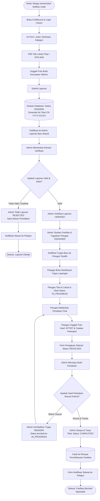

# Activity Diagram & Alur Siklus Laporan
## CivilRecord — Public Facility Reporting & Management System

Dokumen ini mendokumentasikan alur aktivitas bisnis terpadu dari awal masyarakat menemukan fasilitas rusak hingga laporan selesai divalidasi dan dicatat dalam riwayat pemeliharaan aset pemda.

---

### 1. Diagram Alur Aktivitas (Activity Workflow)

---

### 2. Matriks Tanggung Jawab Status (State Responsibility Matrix)

| Status | Pengubah Status | Syarat Transisi | Dampak Sistem |
| :--- | :--- | :--- | :--- |
| **`PENDING`** | Citizen (Sistem) | Form valid & foto terunggah | Muncul di antrean verifikasi admin; pelapor menerima nomor tiket. |
| **`VERIFIED`** | Admin | Foto jelas, lokasi akurat, bukan duplikat | Siap didelegasikan ke petugas dinas terkait. |
| **`REJECTED`** | Admin | Alasan penolakan diisi lengkap | Siklus berakhir; pelapor dapat membaca alasan penolakan. |
| **`ASSIGNED`** | Admin | Petugas dipilih dan SLA ditentukan | Petugas menerima tugas baru di daftar tugasnya. |
| **`IN_PROGRESS`** | Officer | Petugas mengonfirmasi kehadiran di lokasi | Pelapor melihat bahwa perbaikan sedang berlangsung. |
| **`RESOLVED`** | Officer | Minimal 1 foto *After* & catatan perbaikan | Muncul di antrean validasi penyelesaian admin. |
| **`COMPLETED`** | Admin | Foto *Before* & *After* terverifikasi tuntas | Status fasilitas diperbarui (*Baik*); tercatat di buku pemeliharaan aset. |
| **`REWORK`** | Admin | Admin memberikan catatan revisi perbaikan | Status dikembalikan ke `IN_PROGRESS` untuk perbaikan ulang petugas. |
