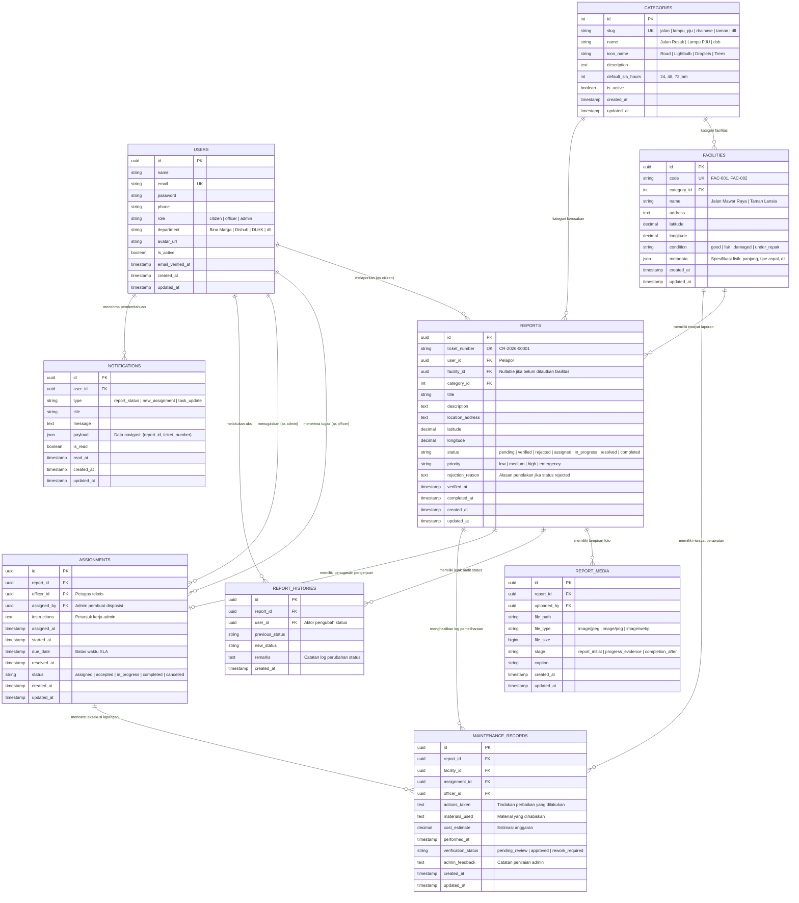

# Entity-Relationship Diagram (ERD) & Skema Database
## CivilRecord — Public Facility Reporting & Management System

Dokumen ini mendefinisikan skema basis data relasional untuk sistem CivilRecord, dirancang untuk mendukung integritas data, jejak audit (*audit trail*), performa geolokasi, dan relasi aset fasilitas.

---

### 1. Diagram ERD Relasional

---

### 2. Spesifikasi Tabel & Index Database

1. **`users`**:
   * Index: `email` (Unique), `role`, `department`.
2. **`categories`**:
   * Index: `slug` (Unique), `is_active`.
3. **`facilities`**:
   * Index: `code` (Unique), `category_id`, `(latitude, longitude)`, `condition`.
4. **`reports`**:
   * Index: `ticket_number` (Unique), `user_id`, `category_id`, `facility_id`, `status`, `created_at`, `(latitude, longitude)`.
5. **`report_media`**:
   * Index: `report_id`, `stage`.
6. **`report_histories`**:
   * Index: `report_id`, `user_id`, `created_at`.
7. **`assignments`**:
   * Index: `report_id`, `officer_id`, `assigned_by`, `status`.
8. **`maintenance_records`**:
   * Index: `facility_id`, `report_id`, `officer_id`, `verification_status`.
9. **`notifications`**:
   * Index: `user_id`, `is_read`, `created_at`.
