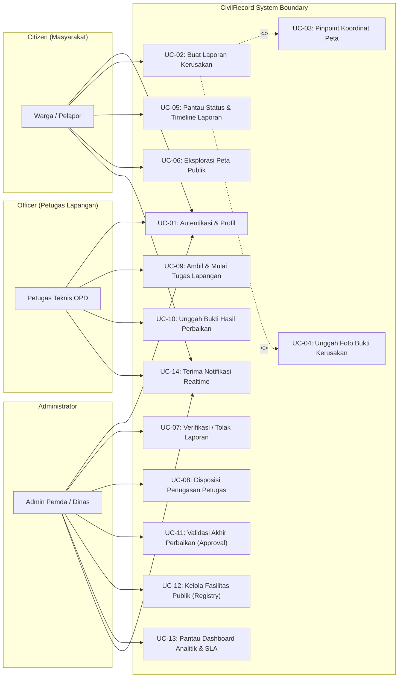

# Use Case Diagram & Spesifikasi Aktor
## CivilRecord — Public Facility Reporting & Management System

---

### 1. Diagram Use Case

---

### 2. Spesifikasi Detail Use Case Utama

#### UC-02: Buat Laporan Kerusakan
* **Aktor Utama**: Citizen (Warga).
* **Pre-kondisi**: Pengguna telah terautentikasi dan login ke dashboard Citizen.
* **Alur Utama**:
  1. Citizen menekan tombol "Buat Laporan".
  2. Sistem menampilkan formulir: Kategori, Judul, Deskripsi, Alamat, Pin Peta, Upload Foto.
  3. Citizen memilih kategori (misal: "Kerusakan Jalan"), mengisi judul dan deskripsi.
  4. Citizen menentukan titik lokasi dengan mengaktifkan GPS browser atau memilih pin di Leaflet Map.
  5. Citizen mengunggah minimal 1 foto bukti kerusakan.
  6. Citizen menekan tombol "Kirim Laporan".
  7. Sistem memvalidasi kelengkapan data, men-generate nomor tiket `CR-YYYY-NNNNN`, mencatat status `PENDING`, dan menyimpan log histori.
  8. Sistem menampilkan pesan sukses beserta rincian tiket pelaporan.

#### UC-07: Verifikasi Laporan Masuk
* **Aktor Utama**: Administrator.
* **Pre-kondisi**: Terdapat laporan berstatus `PENDING` pada antrean verifikasi.
* **Alur Utama**:
  1. Admin membuka halaman Antrean Verifikasi.
  2. Admin memilih satu laporan untuk ditinjau.
  3. Admin memeriksa foto bukti, deskripsi, kesesuaian kategori, dan titik lokasi pada peta.
  4. Admin memeriksa apakah ada laporan duplikat di sekitar lokasi tersebut.
  5. Admin memilih tindakan:
     * **Valid**: Status diubah menjadi `VERIFIED`. Laporan siap ditugaskan.
     * **Tidak Valid**: Status diubah menjadi `REJECTED`, admin mengisi alasan penolakan wajib.
  6. Sistem memperbarui data, mencatat log histori, dan mengirim notifikasi ke pelapor.

#### UC-08: Disposisi Penugasan Petugas
* **Aktor Utama**: Administrator.
* **Pre-kondisi**: Laporan berstatus `VERIFIED`.
* **Alur Utama**:
  1. Admin membuka tab penugasan pada detail laporan.
  2. Admin memilih petugas lapangan dari daftar petugas aktif sesuai dinas terkait.
  3. Admin mengisi instruksi pengerjaan teknis dan tenggat waktu (*due date*).
  4. Admin mengonfirmasi penugasan.
  5. Sistem mengubah status laporan menjadi `ASSIGNED`, membuat entri penugasan, dan mengirimkan notifikasi tugas ke petugas terkait.

#### UC-09 & UC-10: Pengerjaan Lapangan & Unggah Bukti Perbaikan
* **Aktor Utama**: Officer (Petugas Lapangan).
* **Pre-kondisi**: Laporan telah berstatus `ASSIGNED` ke petugas bersangkutan.
* **Alur Utama**:
  1. Petugas membuka menu "Tugas Saya".
  2. Petugas meninjau rincian kerusakan, panduan rute peta, dan instruksi admin.
  3. Saat tiba di lokasi fisik, petugas menekan "Mulai Pengerjaan" (status berubah menjadi `IN_PROGRESS`).
  4. Petugas melakukan perbaikan fasilitas.
  5. Setelah selesai, petugas menekan "Selesaikan Pekerjaan", menulis catatan perbaikan, serta mengunggah foto bukti perbaikan (*After Photo*).
  6. Sistem mencatat status laporan menjadi `RESOLVED` dan memberitahukan admin bahwa perbaikan siap diverifikasi.

#### UC-11: Validasi Akhir Perbaikan (Approval)
* **Aktor Utama**: Administrator.
* **Pre-kondisi**: Laporan berstatus `RESOLVED`.
* **Alur Utama**:
  1. Admin membuka antrean validasi perbaikan.
  2. Admin meninjau perbandingan foto *Before* (dari pelapor) dan *After* (dari petugas), beserta catatan perbaikan.
  3. Admin membuat keputusan:
     * **Sesuai**: Admin menekan "Approve & Selesaikan". Status berubah menjadi `COMPLETED`. Sistem memperbarui kondisi fasilitas umum pada *Facility Registry* menjadi `Baik / Berfungsi`.
     * **Belum Sesuai**: Admin menekan "Minta Revisi". Status dikembalikan ke `IN_PROGRESS` disertai instruksi pengerjaan ulang (*rework*).
  4. Pelapor dan petugas menerima notifikasi hasil validasi.
